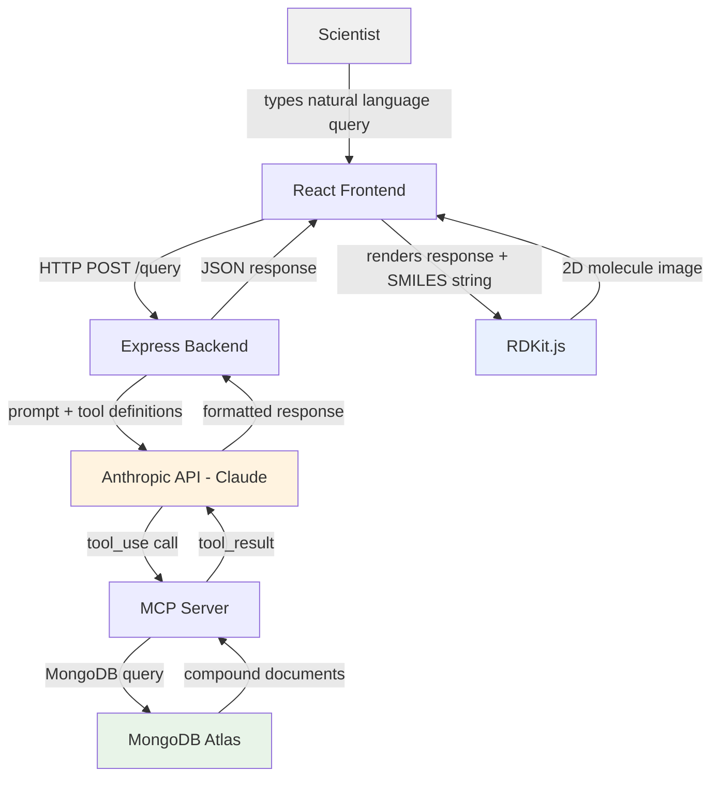
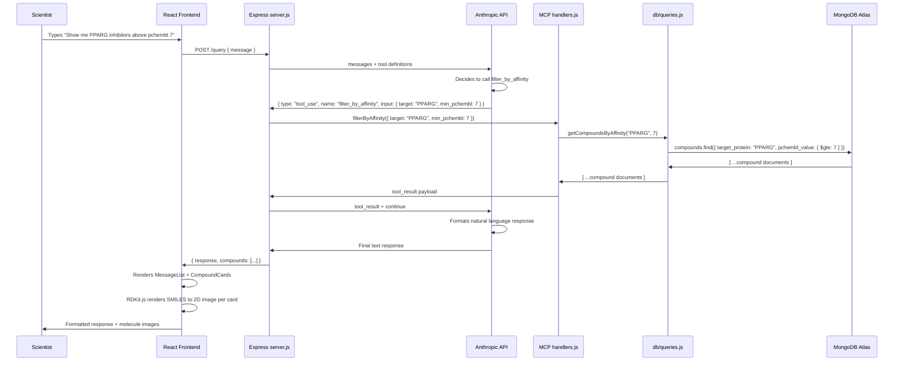

# TFScope — Technical Project Brief

**Role:** Data Engineering / AI/ML Intern
**Company:** Flare Therapeutics, Cambridge MA
**Interview:** April 8, 2026
**Last Updated:** March 28, 2026

> **How to use this document:**
> This is the technical ground truth for Claude Code. Feed it at the start of every session.
> Decision rationale and bug log live in `journal.md` — do not mix them here.
> `TODO` markers indicate sections to be filled in as the build progresses.

---

## 1. Project Overview

TFScope is a natural language research assistant that lets a scientist query a MongoDB database of real drug compounds targeting PPARG and AR using plain English. It is built specifically around Flare Therapeutics' two clinical pipeline targets.

A scientist types a question like "Show me all PPARG inhibitors with a pchembl_value above 7, sorted by potency." The React frontend sends that to an Express backend, which passes it to the Anthropic API. Claude recognizes it needs data, calls a typed MCP tool, the MCP server queries MongoDB, and the real compound data comes back — formatted, readable, and with a 2D molecular structure rendered by RDKit.js.

**What makes it non-trivial:** The LLM does not generate answers from memory. It calls typed MCP tools that retrieve real data from MongoDB. It cannot hallucinate a compound because it is forced to retrieve one. This is the difference between a chatbot and a data retrieval system.

**Targets:**
- **PPARG** (Peroxisome Proliferator-Activated Receptor Gamma) — Flare's FX-909 program, urothelial cancer. ChEMBL ID: `CHEMBL235`
- **AR** (Androgen Receptor) — Flare's FX-111 program, prostate cancer. ChEMBL ID: `CHEMBL1871`

---

## 2. System Diagram

High-level component connections. Read this before anything else.



---

## 3. Folder Structure

Every file annotated with its purpose. Claude Code should create files exactly at these paths.

```
tfscope/
│
├── .env                          # Secret keys — never commit to git
├── .gitignore                    # Must include .env, node_modules/, .DS_Store
├── package.json                  # Project dependencies
├── README.md                     # Project description for GitHub
│
├── server.js                     # Express entry point + serverless-http export
│
├── src/
│   ├── mcp/
│   │   ├── server.js             # MCP server setup and tool registration
│   │   ├── tools.js              # Tool definitions (name, description, inputSchema)
│   │   └── handlers.js           # Tool handler functions — calls db/queries.js
│   │
│   ├── db/
│   │   ├── connection.js         # MongoDB Atlas connection setup via Mongoose
│   │   ├── compound.js           # Mongoose model for the compounds collection
│   │   └── queries.js            # All MongoDB query functions
│   │
│   └── utils/
│       └── transform.js          # ETL transform function (Phase 2)
│
├── seed/
│   └── seed.js                   # Script to manually seed Phase 1 compound documents
│
├── client/                       # React frontend
│   ├── public/
│   │   └── index.html
│   └── src/
│       ├── App.jsx               # Root component — chat layout
│       ├── components/
│       │   ├── ChatInput.jsx     # Text input + submit button
│       │   ├── MessageList.jsx   # Renders conversation history
│       │   └── CompoundCard.jsx  # Displays one compound result + RDKit.js molecule
│       └── services/
│           └── api.js            # fetch() calls to Express backend
│
└── tests/
    ├── unit/
    │   ├── queries.test.js       # Unit tests for MongoDB query functions
    │   └── handlers.test.js      # Unit tests for MCP tool handlers
    └── integration/
        └── flow.test.js          # End-to-end query flow tests
```

---

## 4. Environment Variables

Variable names, purpose, and where each is used. **Never put actual values in this document.**
Actual values live in `.env` only. `.env` must be in `.gitignore`.

```bash
# Anthropic
ANTHROPIC_API_KEY=        # Anthropic API key — get from console.anthropic.com
                          # Used in: server.js when initializing Anthropic client

# MongoDB
MONGODB_URI=              # Atlas connection string — get from Atlas dashboard > Connect
                          # Format: mongodb+srv://<user>:<pass>@cluster.mongodb.net/tfscope
                          # Used in: src/db/connection.js

# Server
PORT=3001                 # Local dev port for Express server
                          # Used in: server.js app.listen()
                          # Note: React runs on 3000, Express on 3001 to avoid conflict

# Environment
NODE_ENV=development      # Set to "production" for Lambda deployment
                          # Used in: server.js to toggle serverless-http export vs app.listen()
```

**Security rules:**
- `.env` is always in `.gitignore` — verify this before first `git push`
- Never paste actual key values into this brief, the build journal, or any chat
- Claude Code reads `.env` directly from the project folder — it does not need values here

---

## 5. Dependencies

Every package the project needs with the reason it was chosen.

### Phase 1 — Install immediately

```bash
npm install express mongoose @anthropic-ai/sdk serverless-http dotenv cors
npm install --save-dev jest nodemon
```

| Package | Purpose |
|---------|---------|
| `express` | HTTP server framework for the backend |
| `mongoose` | MongoDB connection and document modeling |
| `@anthropic-ai/sdk` | Anthropic API client — handles Claude API calls and MCP tool-use |
| `serverless-http` | Wraps Express for AWS Lambda — two lines, zero rewrite needed in Phase 3 |
| `dotenv` | Loads `.env` variables into `process.env` |
| `cors` | Allows React frontend (port 3000) to call Express backend (port 3001) |
| `jest` | Testing framework for unit and integration tests |
| `nodemon` | Auto-restarts server on file changes during development |

### Phase 2 — Install when starting ETL

```bash
npm install axios
```

| Package | Purpose |
|---------|---------|
| `axios` | HTTP client for ChEMBL API calls in the ETL script |

### Frontend — Install inside `/client`

```bash
cd client && npx create-react-app . && npm install @rdkit/rdkit
```

| Package | Purpose |
|---------|---------|
| `react` | Frontend framework — installed via create-react-app |
| `@rdkit/rdkit` | Renders 2D molecule structures from SMILES strings in the browser |

---

## 6. Phase Breakdown

Granular ordered steps for each phase. Each step is small enough to complete in one sitting.
Check off steps as completed. Do not start Phase 2 until all Phase 1 steps are checked.

### Phase 1 — Core Demo (Target: April 5)

**Goal:** Natural language query → MCP tool call → MongoDB → formatted response, running locally end-to-end.

#### Step 1 — Project Setup (~20 min)
- [x] 1.1 Create ~/Desktop/tfscope folder and cd into it (~1 min)
- [x] 1.2 Run git init (~1 min)
- [x] 1.3 Create .gitignore with .env, node_modules/, .DS_Store (~2 min)
- [x] 1.4 Run npm init -y to generate package.json (~1 min)
- [x] 1.5 Install all Phase 1 backend dependencies: npm install express mongoose @anthropic-ai/sdk serverless-http dotenv cors (~3 min)
- [x] 1.6 Install dev dependencies: npm install --save-dev jest nodemon (~2 min)
- [x] 1.7 Create .env file with placeholder variable names (no values) (~2 min)
- [x] 1.8 Create entire folder structure from Section 3 — all directories and empty placeholder files (~5 min)
- [x] 1.9 Add "test": "jest" and "dev": "nodemon server.js" scripts to package.json (~2 min)
- [x] 1.10 First commit: git add . && git commit -m "Phase 1 Step 1: project scaffold" (~1 min)

> **Note:** GitHub repo created at https://github.com/bjt3025/tfscope (private). SSH authentication configured. Steps 1 and 2 commits pushed to `main`.

#### Step 2 — MongoDB Atlas Setup (~25 min)
- [x] 2.1 Create MongoDB Atlas account at mongodb.com/atlas (~3 min)
- [x] 2.2 Create a free M0 cluster — select AWS, us-east-1 (~5 min, includes provisioning wait)
- [x] 2.3 Create a database user with read/write permissions (~2 min)
- [x] 2.4 Whitelist IP address 0.0.0.0/0 for local development (~2 min)
- [x] 2.5 Create database named tfscope and collection named compounds (~3 min)
- [x] 2.6 Copy connection string into .env as MONGODB_URI — replace <password> placeholder with actual password (~3 min)
- [x] 2.7 Add Anthropic API key to .env as ANTHROPIC_API_KEY (~2 min)
- [x] 2.8 Verify .env is in .gitignore before any commit (~1 min)
- [x] 2.9 Commit: "Phase 1 Step 2: env config" (no .env file committed) (~2 min)

#### Step 3 — Database Connection (~15 min)
- [x] 3.1 Write src/db/connection.js — Mongoose connection using process.env.MONGODB_URI, matching the function spec in Section 8 exactly (~5 min)
- [x] 3.2 Add console log on success: "MongoDB connected: <host>" (~1 min)
- [x] 3.3 Add error handling: log error and process.exit(1) on failure — do not catch and continue (~2 min)
- [x] 3.4 Test by running node src/db/connection.js directly — confirm success log, no errors (~3 min)
- [x] 3.5 Test failure case: temporarily break the URI and confirm the process exits with a clear error (~2 min)
- [x] 3.6 Commit: "Phase 1 Step 3: MongoDB connection confirmed" (~2 min)

#### Step 4 — Seed Data (~60 min)
- [x] 4.1 Run curl commands against ChEMBL API for all 9 compounds to pull real SMILES, pchembl_value, mol_weight, alogp, hba, hbd, psa, qed_weighted, inchi_key, max_phase, first_approval, withdrawn_flag (~20 min)
- [x] 4.2 Record all verified values somewhere temporary so they can be transcribed into seed documents (~5 min)
- [x] 4.3 Write seed/seed.js — script that connects to MongoDB and inserts 9 documents (~10 min)
- [x] 4.3a Write src/db/compound.js — Mongoose model for the compounds collection, required by seed.js to call insertMany()

  ```javascript
  const mongoose = require('mongoose')

  const compoundSchema = new mongoose.Schema({
    chembl_id: String, name: String, smiles: String, inchi_key: String,
    target_protein: String, target_chembl_id: String, target_full_name: String,
    assay_chembl_id: String, assay_description: String, assay_type: String,
    document_journal: String, document_year: Number,
    standard_value: Number, standard_relation: String, standard_units: String,
    pchembl_value: Number,
    ligand_efficiency: { bei: Number, le: Number, lle: Number, sei: Number },
    mol_weight: Number, alogp: Number, hba: Number, hbd: Number,
    psa: Number, qed_weighted: Number, num_ro5_violations: Number,
    max_phase: Number, first_approval: Number, withdrawn_flag: Boolean,
    source: String, created_at: Date
  })

  module.exports = mongoose.model('Compound', compoundSchema)
  // 'Compound' → Mongoose auto-pluralizes to 'compounds' collection in MongoDB
  ```

- [x] 4.4 Write all 9 compound documents in the exact schema shape from Section 10 — every field present, every type correct (numbers as numbers, not strings) (~15 min)
- [x] 4.5 Run node seed/seed.js — confirm "9 documents inserted" or equivalent (~2 min)
- [x] 4.6 Open Atlas UI — visually verify 9 documents exist in the compounds collection (~3 min)
- [x] 4.7 Spot-check at least 2 documents in Atlas: confirm numeric fields are stored as numbers, SMILES strings look like real molecular notation (~3 min)
- [x] 4.8 Commit: "Phase 1 Step 4: 9 seed compounds inserted" (~2 min)

#### Step 5 — MongoDB Query Functions (~45 min)
- [ ] 5.1 Write getCompoundsByTarget(target) in src/db/queries.js — .find({ target_protein }), returns [] on no results, never throws (~8 min)
- [ ] 5.2 Write getCompoundsByAffinity(target, minPchembl) — .find() with $gte filter, .sort({ pchembl_value: -1 }), returns [] on no results (~8 min)
- [ ] 5.3 Write getCompoundById(chemblId) — .findOne({ chembl_id }), returns null if not found (~5 min)
- [ ] 5.4 Write all 8 unit tests in tests/unit/queries.test.js matching Section 11 spec (QU-01 through QU-08) (~15 min)
- [ ] 5.5 Run npm test — all 8 tests must pass (~5 min, including debugging)
- [ ] 5.6 Commit: "Phase 1 Step 5: query functions + tests passing" (~2 min)

#### Step 6 — MCP Tool Definitions and Handlers (~45 min)
- [ ] 6.1 Write src/mcp/tools.js — export the array of 3 tool definition objects exactly as specified in Section 8 (search_by_target, filter_by_affinity, get_compound_details) (~10 min)
- [ ] 6.2 Write searchByTarget(input) handler in src/mcp/handlers.js — validates input, calls getCompoundsByTarget(), returns { compounds } or { compounds: [], error } (~8 min)
- [ ] 6.3 Write filterByAffinity(input) handler — calls getCompoundsByAffinity(), same error pattern (~5 min)
- [ ] 6.4 Write getCompoundDetails(input) handler — calls getCompoundById(), returns { compound } or { compound: null, error } (~5 min)
- [ ] 6.5 Write all 4 handler unit tests in tests/unit/handlers.test.js matching Section 11 (HU-01 through HU-04) (~10 min)
- [ ] 6.6 Run npm test — all query + handler tests pass (~5 min)
- [ ] 6.7 Commit: "Phase 1 Step 6: MCP tools + handlers + tests passing" (~2 min)

#### Step 7 — Express Server and Anthropic API (~60 min)
- [ ] 7.1 Write server.js skeleton — Express app, dotenv config, CORS middleware, serverless-http export at bottom, app.listen() conditional on NODE_ENV (~10 min)
- [ ] 7.2 Import and call connectDB() on startup (~3 min)
- [ ] 7.3 Initialize Anthropic client using process.env.ANTHROPIC_API_KEY (~3 min)
- [ ] 7.4 Write dispatchTool(name, input) — maps tool names to handler functions exactly as shown in Section 8 pseudocode (~5 min)
- [ ] 7.5 Write POST /query endpoint — receives { message }, sends to Anthropic API with tool definitions from tools.js (~10 min)
- [ ] 7.6 Implement the tool-use loop: detect stop_reason === "tool_use", extract tool call, dispatch to handler, send tool_result back to Anthropic, get final response (~15 min)
- [ ] 7.7 Return { response, compounds } to client — extract compound data from tool result to send alongside Claude's text response (~5 min)
- [ ] 7.8 Add error handling: try/catch around the whole endpoint, return { error } with HTTP 500 on failure (~3 min)
- [ ] 7.9 Start server with node server.js, test with curl: curl -X POST http://localhost:3001/query -H "Content-Type: application/json" -d '{"message": "Show me PPARG compounds"}' (~5 min)
- [ ] 7.10 Confirm JSON response contains real compound data from MongoDB (~2 min)
- [ ] 7.11 Commit: "Phase 1 Step 7: Express + Anthropic API working via curl" (~2 min)

#### Step 8A — React Project Scaffolding (frontend) (~20 min)
- [ ] 8A.1 Run npx create-react-app client inside tfscope/ (~5 min)
- [ ] 8A.2 Install RDKit.js: cd client && npm install @rdkit/rdkit (~3 min)
- [ ] 8A.3 Clean out default Create React App boilerplate from App.jsx, App.css, index.css (~3 min)
- [ ] 8A.4 Create component and services directory structure: components/, services/ (~2 min)
- [ ] 8A.5 Set up proxy in client/package.json — add "proxy": "http://localhost:3001" (~2 min)
- [ ] 8A.6 Verify npm start inside client/ launches React on port 3000 without errors (~3 min)
- [ ] 8A.7 Commit: "Phase 1 Step 8A: React scaffolding" (~2 min)

#### Step 8B — API Service Layer and Chat Input (frontend) (~25 min)
- [ ] 8B.1 Write client/src/services/api.js — fetch() POST to /query with { message }, returns parsed JSON (~8 min)
- [ ] 8B.2 Write ChatInput.jsx — controlled text input, submit button, calls onSubmit(message) prop, clears input after submit (~10 min)
- [ ] 8B.3 Wire ChatInput into App.jsx temporarily — on submit call api.js, log response to console (~5 min)
- [ ] 8B.4 Test: type "Show me PPARG compounds" in browser, confirm compound data appears in console (~2 min)

#### Step 8C — Message List and Conversation State (frontend) (~30 min)
- [ ] 8C.1 Define conversation state in App.jsx — array of message objects [{ role: "user" | "assistant", text, compounds }] (~5 min)
- [ ] 8C.2 Write MessageList.jsx — receives messages array, renders each as a block with user/assistant distinction (~15 min)
- [ ] 8C.3 Wire state: on submit, add user message → call API → add assistant response + compounds to state (~5 min)
- [ ] 8C.4 Add loading state — show loading indicator while waiting for API response (~3 min)
- [ ] 8C.5 Test: submit a query, see both user message and assistant text response rendered in chat (~2 min)

#### Step 8D — CompoundCard (frontend) (~30 min)
- [ ] 8D.1 Write CompoundCard.jsx — receives compound object, displays: name, target_protein, pchembl_value, standard_value + units, max_phase, withdrawn_flag (~15 min)
- [ ] 8D.2 Display SMILES string as plain text on the card — no rendering yet, just visible for verification (~5 min)
- [ ] 8D.3 Wire CompoundCard into MessageList — when a message has compounds, render a CompoundCard for each (~5 min)
- [ ] 8D.4 Test: submit a query, confirm compound cards appear with all fields correctly displayed (~3 min)
- [ ] 8D.5 Commit: "Phase 1 Step 8D: CompoundCard working" (~2 min)

#### Step 8D-optional — RDKit.js Molecule Rendering (frontend) (~60 min, only if time allows after Step 9)
- [ ] 8D-opt.1 Research RDKit.js initialization — correct async WASM loading pattern for React (~15 min)
- [ ] 8D-opt.2 Set up RDKit.js initialization in App.jsx or dedicated context provider — load WASM on mount, store instance in state (~15 min)
- [ ] 8D-opt.3 Add SMILES → 2D SVG rendering in CompoundCard using initialized RDKit instance (~10 min)
- [ ] 8D-opt.4 Handle edge cases: invalid SMILES → "structure unavailable" fallback, RDKit not loaded → placeholder (~5 min)
- [ ] 8D-opt.5 Test: confirm molecule images render for all 9 seed compounds (~5 min)
- [ ] 8D-opt.6 Commit: "Phase 1 Step 8D-optional: RDKit.js molecule rendering added" (~2 min)

#### Step 8E — Full Frontend Integration and Polish (frontend) (~30 min)
- [ ] 8E.1 Test full flow: type query → see assistant text + compound cards (~5 min)
- [ ] 8E.2 Handle "no results" case — assistant text says no compounds found, no empty cards rendered (~5 min)
- [ ] 8E.3 Handle non-scientific queries — Claude responds conversationally, no cards rendered (~3 min)
- [ ] 8E.4 Handle API errors — show user-friendly error message, don't crash the app (~5 min)
- [ ] 8E.5 Basic styling pass — chat readable, cards visually distinct, layout clean (~10 min)
- [ ] 8E.6 Commit: "Phase 1 Step 8: React frontend complete" (~2 min)

#### Step 9 — End-to-End Validation (~45 min)
- [ ] 9.1 Write integration tests in tests/integration/flow.test.js — all 6 tests from Section 11 (IT-01 through IT-06) (~20 min)
- [ ] 9.2 Run integration tests, debug and fix any failures (~10 min)
- [ ] 9.3 Manually run all 5 demo tests from Section 11 (DM-01 through DM-05) in the browser (~5 min)
- [ ] 9.4 Write README.md — project description, how to install, how to run locally, what the demo does (~5 min)
- [ ] 9.5 Final commit: "Phase 1 complete: end-to-end demo working" (~2 min)

---

### Phase 2 — Engineering Layer (Target: April 6–7)

**Goal:** Replace manually seeded data with a real ETL pipeline. Add proteomics collection. Add compare tool.
**Prerequisite:** All Phase 1 steps checked off and demo working end-to-end.

- [ ] Write `src/utils/transform.js` — ETL transform function (see Section 8)
- [ ] Write ETL script that calls ChEMBL activity endpoint for PPARG (`CHEMBL235`) and AR (`CHEMBL1871`)
- [ ] For each activity record fetch molecule data from molecule endpoint
- [ ] Run transform on each pair and upsert into MongoDB using `chembl_id` as key
- [ ] Verify upserted documents match schema — confirm all numeric fields parsed correctly
- [ ] Confirm no duplicate documents created — upsert should overwrite seed data cleanly
- [ ] TODO: Define proteomics collection schema
- [ ] TODO: Seed proteomics collection with covalent fragment binding data
- [ ] Add `compare_compounds` MCP tool definition and handler
- [ ] Update integration tests for new tool

---

### Phase 3 — AWS Deployment (Stretch / Post-Interview)

**Goal:** Live deployment. Zero rewrites needed — serverless-http already in place.

- [ ] Deploy React frontend to AWS Amplify — connect GitHub repo, click deploy
- [ ] Package Express server for Lambda: `zip -r function.zip . -x "*.git*" "client/*" "tests/*"`
- [ ] Create Lambda function in AWS console — Node.js runtime
- [ ] Upload zip, set handler to `server.handler` (the serverless-http export)
- [ ] Set all `.env` variables as Lambda environment variables in AWS console
- [ ] Create API Gateway HTTP API — route ALL requests to Lambda function
- [ ] Update React `api.js` to point to API Gateway URL instead of localhost
- [ ] Redeploy Amplify with updated API URL
- [ ] Test full flow against live deployment

---

## 7. Call Flow Diagram

Step-by-step sequence through a single user query. Read this before the function reference in Section 8.



---

## 8. Function Reference

Every function in the project with parameters, return shape, callers, callees, and error handling.

---

### `src/db/connection.js`

#### `connectDB()`
**Purpose:** Establish MongoDB Atlas connection via Mongoose
**Parameters:** None
**Returns:** `Promise<void>`
**Called by:** `server.js` on startup
**Calls:** `mongoose.connect(process.env.MONGODB_URI)`
**Error handling:** Logs error and calls `process.exit(1)` if connection fails — server must not start without a database connection

```javascript
// Expected log on success
"MongoDB connected: cluster0.mongodb.net"

// Expected behavior on failure
// Logs error message then exits process — do not catch and continue
```

---

### `src/db/queries.js`

#### `getCompoundsByTarget(target)`
**Purpose:** Return all compounds for a given target protein
**Parameters:**
- `target` — string, must be `"PPARG"` or `"AR"`

**Returns:** `Promise<Array<CompoundDocument>>`
**Called by:** `handlers.js` → `searchByTarget()`
**Calls:** Mongoose `.find()` on compounds collection
**Error handling:** Returns `[]` if no results — never throws to caller

```javascript
// Expected input
getCompoundsByTarget("PPARG")

// Expected output shape
[
  { chembl_id: "CHEMBL121", name: "Rosiglitazone", pchembl_value: 7.52, smiles: "...", ... },
  { chembl_id: "CHEMBL595", name: "Pioglitazone", pchembl_value: 7.10, smiles: "...", ... }
]

// Edge case: unknown target → []
```

---

#### `getCompoundsByAffinity(target, minPchembl)`
**Purpose:** Return compounds for a target filtered by minimum pchembl_value, sorted descending
**Parameters:**
- `target` — string, `"PPARG"` or `"AR"`
- `minPchembl` — float, minimum pchembl_value (e.g. `7.0`)

**Returns:** `Promise<Array<CompoundDocument>>`
**Called by:** `handlers.js` → `filterByAffinity()`
**Calls:** Mongoose `.find()` with `$gte` filter and `.sort({ pchembl_value: -1 })`
**Error handling:** Returns `[]` if no results above threshold

```javascript
// Expected input
getCompoundsByAffinity("PPARG", 7.0)

// Expected output — sorted highest pchembl_value first
[
  { chembl_id: "CHEMBL121", pchembl_value: 7.52, ... },
  { chembl_id: "CHEMBL595", pchembl_value: 7.10, ... }
]

// Edge case: threshold too high → []
```

---

#### `getCompoundById(chemblId)`
**Purpose:** Return a single compound document by ChEMBL ID
**Parameters:**
- `chemblId` — string, e.g. `"CHEMBL121"`

**Returns:** `Promise<CompoundDocument | null>`
**Called by:** `handlers.js` → `getCompoundDetails()`
**Calls:** Mongoose `.findOne({ chembl_id: chemblId })`
**Error handling:** Returns `null` if not found — caller handles null

```javascript
// Expected input
getCompoundById("CHEMBL121")

// Expected output
{ chembl_id: "CHEMBL121", name: "Rosiglitazone", smiles: "...", pchembl_value: 7.52, ... }

// Edge case: not in database → null
```

---

### `src/mcp/tools.js`

Not functions — exports an array of MCP tool definition objects sent to the Anthropic API with every request. Claude reads these to know what tools exist and what parameters they accept.

```javascript
module.exports = [
  {
    name: "search_by_target",
    description: "Search the compound database for all molecules targeting a specific protein. Use when the user asks about compounds for PPARG or AR without specifying a potency threshold.",
    inputSchema: {
      type: "object",
      properties: {
        target: {
          type: "string",
          enum: ["PPARG", "AR"],
          description: "The target protein to search for"
        }
      },
      required: ["target"]
    }
  },
  {
    name: "filter_by_affinity",
    description: "Return compounds for a target protein filtered by minimum potency. pchembl_value is -log10(IC50) — higher values mean more potent. Use when the user specifies a potency threshold or asks for potent or strong compounds.",
    inputSchema: {
      type: "object",
      properties: {
        target: { type: "string", enum: ["PPARG", "AR"] },
        min_pchembl: {
          type: "number",
          description: "Minimum pchembl_value threshold. Typical range: 5.0 (weak) to 9.0 (very potent)"
        }
      },
      required: ["target", "min_pchembl"]
    }
  },
  {
    name: "get_compound_details",
    description: "Return full details for a single compound by its ChEMBL ID. Use when the user asks about a specific named compound or requests more detail on one result.",
    inputSchema: {
      type: "object",
      properties: {
        chembl_id: {
          type: "string",
          description: "The ChEMBL ID of the compound, e.g. CHEMBL121"
        }
      },
      required: ["chembl_id"]
    }
  }
]
```

---

### `src/mcp/handlers.js`

#### `searchByTarget(input)`
**Purpose:** MCP handler for `search_by_target` — validates input and calls query function
**Parameters:** `input` — object: `{ target: string }`
**Returns:** `Promise<{ compounds: Array<CompoundDocument> }>`
**Called by:** `server.js` tool dispatch logic
**Calls:** `getCompoundsByTarget()` in `src/db/queries.js`
**Error handling:** Returns `{ compounds: [], error: "message" }` on failure — never throws

---

#### `filterByAffinity(input)`
**Purpose:** MCP handler for `filter_by_affinity`
**Parameters:** `input` — object: `{ target: string, min_pchembl: number }`
**Returns:** `Promise<{ compounds: Array<CompoundDocument> }>`
**Called by:** `server.js` tool dispatch logic
**Calls:** `getCompoundsByAffinity()` in `src/db/queries.js`
**Error handling:** Returns `{ compounds: [], error: "message" }` on failure

---

#### `getCompoundDetails(input)`
**Purpose:** MCP handler for `get_compound_details`
**Parameters:** `input` — object: `{ chembl_id: string }`
**Returns:** `Promise<{ compound: CompoundDocument | null }>`
**Called by:** `server.js` tool dispatch logic
**Calls:** `getCompoundById()` in `src/db/queries.js`
**Error handling:** Returns `{ compound: null, error: "Compound not found" }` if null

---

### `server.js`

#### `POST /query`
**Purpose:** Main endpoint — receives natural language query, orchestrates Anthropic API + MCP tool loop, returns formatted response
**Request body:** `{ message: string }`
**Returns:** `{ response: string, compounds: Array | null }`
**Called by:** `client/src/services/api.js`
**Calls:** Anthropic API client, MCP handler functions via `dispatchTool()`
**Error handling:** Returns `{ error: "message" }` with HTTP 500 on unhandled failure

```javascript
// Tool dispatch pseudocode
const response = await anthropic.messages.create({ messages, tools })

if (response.stop_reason === "tool_use") {
  const toolUse = response.content.find(b => b.type === "tool_use")
  const result = await dispatchTool(toolUse.name, toolUse.input)
  // Send tool_result back to Anthropic, get final formatted response
}

// dispatchTool maps tool name to handler
function dispatchTool(name, input) {
  const map = {
    search_by_target:    () => searchByTarget(input),
    filter_by_affinity:  () => filterByAffinity(input),
    get_compound_details: () => getCompoundDetails(input)
  }
  return map[name]?.() ?? { error: "Unknown tool" }
}
```

**serverless-http export — must be at bottom of file:**
```javascript
// Runs locally
if (process.env.NODE_ENV !== "production") {
  app.listen(process.env.PORT || 3001, () => console.log("Server running"))
}

// Exports for Lambda
const serverless = require("serverless-http")
module.exports.handler = serverless(app)
```

---

### `src/utils/transform.js` — Phase 2

#### `transformActivity(activity, molecule)`
**Purpose:** ETL transform — converts raw ChEMBL API response pair into a MongoDB document matching the project schema exactly
**Parameters:**
- `activity` — raw object from ChEMBL `/activity` endpoint
- `molecule` — raw object from ChEMBL `/molecule/{id}` endpoint

**Returns:** A single compound document matching the schema in Section 10
**Called by:** ETL script (Phase 2)
**Calls:** Nothing — pure transform function, no side effects
**Error handling:** Uses `?? null` for all optional fields — never throws on missing data

**Key type conversions this function must perform:**

| From API | Transform | To schema |
|----------|-----------|-----------|
| `activity.standard_value` = `"30.0"` | `parseFloat()` | `standard_value: 30.0` |
| `activity.pchembl_value` = `"7.52"` | `parseFloat()` | `pchembl_value: 7.52` |
| `molecule.max_phase` = `"4.0"` | `parseInt()` | `max_phase: 4` |
| `molecule.molecule_structures.standard_inchi_key` | rename | `inchi_key` |
| `activity.target_chembl_id === "CHEMBL235"` | derive | `target_protein: "PPARG"` |

---

### `client/src/components/CompoundCard.jsx`

#### `CompoundCard({ compound })`
**Purpose:** Renders a single compound result card with 2D molecule structure
**Parameters:** `compound` — a compound document object from MongoDB
**Returns:** JSX card displaying: name, target, pchembl_value, standard_value (nM), max_phase, withdrawn_flag, and a 2D molecule image from RDKit.js
**Called by:** `MessageList.jsx`
**Calls:** RDKit.js WASM module to render SMILES → SVG image

```javascript
// TODO: Fill in exact RDKit.js initialization pattern when implementing
// RDKit.js requires async WASM initialization — must be handled before rendering
// Pattern: load RDKit once at app level, pass to CompoundCard as prop or context
```

---

## 9. Seed Data Spec

9 real compounds seeded manually in Phase 1. Chosen to cover both targets, a range of potencies, and at least two approved drugs per target for demo variety.

### PPARG Compounds (4)

| # | Name | ChEMBL ID | Notes |
|---|------|-----------|-------|
| 1 | Rosiglitazone | CHEMBL121 | Approved then withdrawn — classic PPARG agonist, reference compound |
| 2 | Pioglitazone | CHEMBL595 | Approved drug still in use — good contrast with withdrawn rosiglitazone |
| 3 | T0070907 | CHEMBL195743 | PPARG antagonist — shows mechanism diversity beyond agonists |
| 4 | SR1664 | CHEMBL2180676 | Non-agonist PPARG modulator — more recent compound class |

### AR Compounds (5)

| # | Name | ChEMBL ID | Notes |
|---|------|-----------|-------|
| 5 | Enzalutamide | CHEMBL1082407 | Approved for mCRPC — directly relevant to Flare FX-111 program |
| 6 | Bicalutamide | CHEMBL409 | Older approved AR antagonist — good historical contrast |
| 7 | Apalutamide | CHEMBL3183409 | Next-gen approved AR antagonist |
| 8 | Darolutamide | CHEMBL4297185 | Approved, structurally distinct from enzalutamide |
| 9 | ARN-509 | CHEMBL2180681 | Clinical compound, close analog to enzalutamide |

---

## 10. MongoDB Schema — Finalized

Derived from real ChEMBL API responses on March 28, 2026.
**Do not modify field names without updating all query functions and MCP tool handlers.**

```json
{
  "chembl_id": "CHEMBL121",
  "name": "Rosiglitazone",
  "target_protein": "PPARG",
  "target_chembl_id": "CHEMBL235",
  "target_full_name": "Peroxisome proliferator-activated receptor gamma",

  "assay_chembl_id": "CHEMBL759452",
  "assay_description": "In vitro binding affinity against human PPARG",
  "assay_type": "B",
  "document_journal": "Bioorg Med Chem Lett",
  "document_year": 2003,

  "standard_value": 30.0,
  "standard_relation": "=",
  "standard_units": "nM",
  "pchembl_value": 7.52,
  "ligand_efficiency": { "bei": 12.25, "le": 0.23, "lle": -0.96, "sei": 8.85 },

  "smiles": "CN(CCOc1ccc(CC2SC(=O)NC2=O)cc1)c1ccccn1",
  "inchi_key": "YASAKCUCGLMORW-UHFFFAOYSA-N",

  "mol_weight": 357.44,
  "alogp": 2.49,
  "hba": 6,
  "hbd": 1,
  "psa": 71.53,
  "qed_weighted": 0.82,
  "num_ro5_violations": 0,

  "max_phase": 4,
  "first_approval": 1999,
  "withdrawn_flag": true,

  "source": "chembl",
  "created_at": "2026-03-28T00:00:00Z"
}
```

### Critical type rules — ETL and seed data must follow these

| Field | API returns | Store as | Method |
|-------|------------|----------|--------|
| `standard_value` | `"30.0"` (string) | `30.0` (float) | `parseFloat()` |
| `pchembl_value` | `"7.52"` (string) | `7.52` (float) | `parseFloat()` |
| `max_phase` | `"4.0"` (string) | `4` (int) | `parseInt()` |
| `mol_weight` | `"357.44"` (string) | `357.44` (float) | `parseFloat()` |
| `alogp` | `"2.49"` (string) | `2.49` (float) | `parseFloat()` |
| `psa` | `"71.53"` (string) | `71.53` (float) | `parseFloat()` |
| `qed_weighted` | `"0.82"` (string) | `0.82` (float) | `parseFloat()` |
| `inchi_key` | named `standard_inchi_key` in API | stored as `inchi_key` | rename in transform |
| `target_protein` | not in API | `"PPARG"` or `"AR"` | derive from `target_chembl_id` |

---

## 11. Testing Suite

### Unit Tests — `tests/unit/queries.test.js`

| Test ID | Function | Input | Pass Condition |
|---------|----------|-------|----------------|
| QU-01 | `getCompoundsByTarget` | `"PPARG"` | Returns array, length > 0, all have `target_protein: "PPARG"` |
| QU-02 | `getCompoundsByTarget` | `"AR"` | Returns array, length > 0, all have `target_protein: "AR"` |
| QU-03 | `getCompoundsByTarget` | `"UNKNOWN"` | Returns `[]`, does not throw |
| QU-04 | `getCompoundsByAffinity` | `"PPARG", 7.0` | All results have `pchembl_value >= 7.0` |
| QU-05 | `getCompoundsByAffinity` | `"PPARG", 7.0` | Results sorted by `pchembl_value` descending |
| QU-06 | `getCompoundsByAffinity` | `"PPARG", 12.0` | Returns `[]`, does not throw |
| QU-07 | `getCompoundById` | `"CHEMBL121"` | Returns Rosiglitazone document |
| QU-08 | `getCompoundById` | `"CHEMBL999999"` | Returns `null`, does not throw |

### Unit Tests — `tests/unit/handlers.test.js`

| Test ID | Handler | Input | Pass Condition |
|---------|---------|-------|----------------|
| HU-01 | `searchByTarget` | `{ target: "PPARG" }` | Returns `{ compounds: [...] }` |
| HU-02 | `filterByAffinity` | `{ target: "PPARG", min_pchembl: 7.0 }` | Returns filtered compounds array |
| HU-03 | `getCompoundDetails` | `{ chembl_id: "CHEMBL121" }` | Returns `{ compound: { ... } }` |
| HU-04 | `getCompoundDetails` | `{ chembl_id: "CHEMBL999999" }` | Returns `{ compound: null, error: "..." }` without throwing |

### Integration Tests — `tests/integration/flow.test.js`

| Test ID | Natural Language Query | Pass Condition |
|---------|----------------------|----------------|
| IT-01 | "Show me all PPARG compounds" | Returns 5 PPARG compounds, all have `smiles` field |
| IT-02 | "Show me potent PPARG inhibitors above pchembl 7.5" | All results have `pchembl_value >= 7.5` |
| IT-03 | "Tell me about Rosiglitazone" | Returns CHEMBL121 details |
| IT-04 | "Show me AR compounds" | Returns 5 AR compounds |
| IT-05 | "What are the most potent AR inhibitors?" | AR compounds sorted descending by `pchembl_value` |
| IT-06 | "Show me approved PPARG drugs" | Returns compounds with `max_phase = 4` |

### Manual Demo Tests — run before interview

| Test ID | Steps | Pass Condition |
|---------|-------|----------------|
| DM-01 | Type "Show me PPARG compounds" | Compound cards appear with 2D molecule images |
| DM-02 | Type "Show me potent AR drugs above pchembl 8" | Only high-potency AR compounds shown |
| DM-03 | Ask about a specific compound by name | Correct compound card returned |
| DM-04 | Ask a question with no matching results | Graceful "no results" message, no crash |
| DM-05 | Ask a non-scientific question | Claude responds naturally, no crash |

---

---

## Notes for Future Self

- MongoDB Atlas account and Anthropic (Claude) API key were both created using **benjthomas@umass.edu**
- **Action required before Step 3:** The `MONGODB_URI` in `.env` still has `<benjthomas_db_user>` as a placeholder for the password — replace it with the actual Atlas database user password before running the connection test
